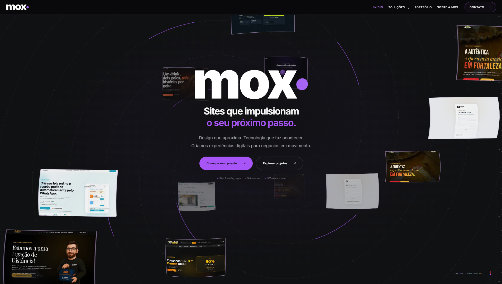
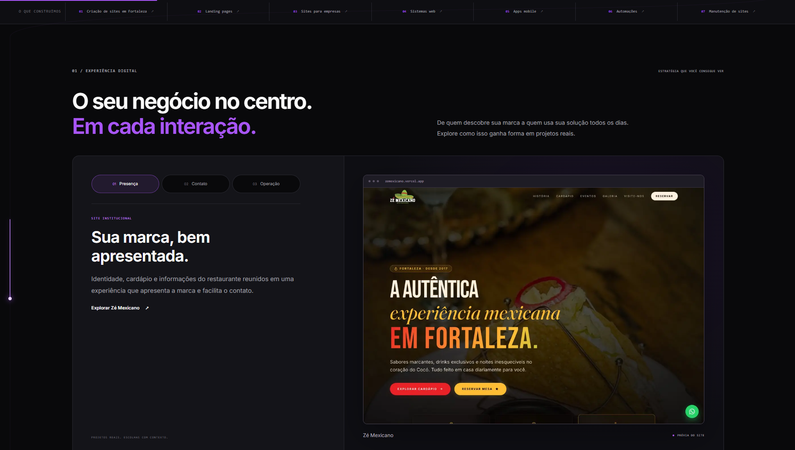
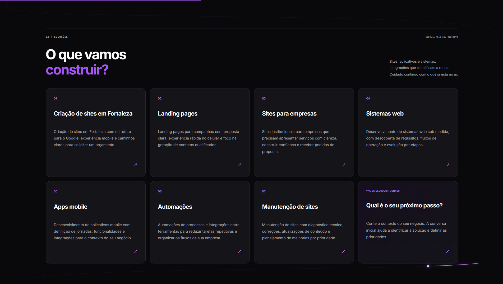
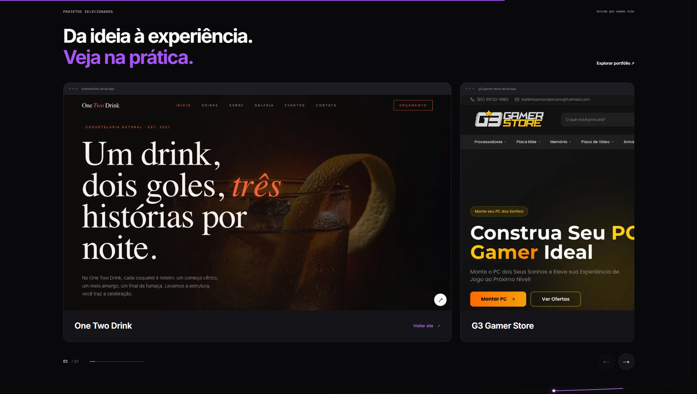

  

  # MOX. — Desenvolvimento & Experiências Digitais

  **Site institucional e portfólio de tecnologia, design e estratégia.**

  Fortaleza, Ceará · Atendimento online em todo o Brasil

  [Portfólio](./src/lib/projects.ts) · [Arquitetura](./docs/ARCHITECTURE.md) · [Segurança](./SECURITY.md)

---

## Sobre o projeto

A **MOX.** desenvolve soluções digitais para negócios que precisam comunicar melhor o seu valor e transformar presença online em oportunidades de contato.

Este repositório contém a aplicação institucional da empresa, construída em **Next.js App Router**. Ela reúne conteúdo sobre serviços, estudos de experiência digital apresentados no portfólio e um briefing que prepara uma mensagem comercial para envio pelo WhatsApp.

A implementação foi organizada para privilegiar **conteúdo legível, renderização adequada à indexação, navegação responsiva, interação progressiva e manutenção previsível**.

> **Escopo real:** site institucional e portfólio. Não há neste repositório autenticação, backend de CRM, banco de dados, checkout ou armazenamento de leads. A interação de contato prepara uma mensagem para revisão e envio pelo próprio visitante.

## Galeria do site

### Hero orbital

### Experiência digital

### Serviços

### Portfólio

**Mais capturas** · [Metodologia de projeto](./docs/capturas/metodologia-de-projeto.webp) · [Perguntas frequentes](./docs/capturas/perguntas-frequentes.webp) · [Contato e rodapé](./docs/capturas/contato-e-rodape.webp)

## Funcionalidades

| Capacidade | Implementação |
| --- | --- |
| Navegação | Página inicial, sobre, portfólio, contato, sete páginas de serviços e rota 404 |
| Serviços | Conteúdo centralizado, usado nas rotas dinâmicas, navegação e sitemap |
| Portfólio | Projetos publicados com descrições, prévias e links externos |
| Contato | Briefing com validação no navegador e encaminhamento via WhatsApp |
| SEO | Metadados, canonical, Open Graph, Twitter, sitemap, robots e dados estruturados |
| Experiência | GSAP/ScrollTrigger, cenas com Three.js e alternativa para movimento reduzido |
| Qualidade | ESLint, TypeScript estrito, testes Playwright e validação contínua no GitHub |

**Importante:** ter recursos técnicos de SEO ou performance não garante classificação nos buscadores nem pontuações de Core Web Vitals. Esses resultados precisam ser medidos no ambiente público.

## Tecnologias

- **Next.js 16** — App Router, geração das páginas, metadados e otimização de imagens.
- **React 19 + TypeScript 6** — componentes e contratos tipados.
- **Tailwind CSS 4 + CSS** — implementação visual e responsividade.
- **GSAP + ScrollTrigger** — movimento como aprimoramento progressivo.
- **Three.js** — experiências gráficas com fallback.
- **Playwright** — testes funcionais.
- **ESLint + Prettier** — suporte à qualidade e padronização do código.

As versões efetivamente instaladas são resolvidas pelo `package-lock.json`.

## Arquitetura

~~~text
.
├── public/
│   ├── projects/             # Capturas dos projetos
│   └── services/             # Imagens das páginas de serviços
├── src/
│   ├── app/
│   │   ├── [slug]/            # Rotas de serviço
│   │   ├── contato/
│   │   ├── portfolio/
│   │   ├── sobre/
│   │   ├── layout.tsx         # Layout e metadados globais
│   │   ├── robots.ts
│   │   └── sitemap.ts
│   ├── components/           # Interface, contato, movimento e apresentação
│   └── lib/
│       ├── site.ts            # Configuração, SEO e conteúdo dos serviços
│       ├── projects.ts        # Catálogo do portfólio
│       └── *spiral*.ts        # Recursos gráficos
├── tests/e2e/                # Smoke tests de navegação
├── docs/                     # Documentação arquitetural
├── .github/workflows/        # CI
└── playwright.config.ts
~~~

A fonte de verdade para serviços é `src/lib/site.ts`; a fonte de projetos é `src/lib/projects.ts`. As páginas consomem esses dados em vez de duplicá-los. Consulte o [documento de arquitetura](./docs/ARCHITECTURE.md) para detalhes e decisões técnicas.

## Configuração local

**Pré-requisitos:** Node.js 22 LTS (recomendado), npm e Git.

~~~bash
git clone https://github.com/KayohanCosta/mox-desenvolvimento.git
cd mox-desenvolvimento
npm ci
cp .env.example .env.local
npm run dev
~~~

No PowerShell, copie o arquivo usando `Copy-Item .env.example .env.local`.

Acesse **http://127.0.0.1:3000**.

### Variáveis de ambiente

| Variável | Finalidade | Padrão |
| --- | --- | --- |
| `NEXT_PUBLIC_SITE_URL` | URL base de canonical, sitemap, Open Graph e JSON-LD | `http://localhost:3000` |
| `NEXT_PUBLIC_ALLOW_INDEXING` | Habilita indexação apenas com URL HTTPS | `false` |
| `NEXT_PUBLIC_WHATSAPP_NUMBER` | Número de destino no formato internacional `55DDDNUMERO` | Fallback em `src/lib/site.ts` |
| `GOOGLE_SITE_VERIFICATION` | Token opcional de validação do Search Console | Não definido |

O arquivo [.env.example](./.env.example) contém valores de exemplo, não credenciais. Arquivos `.env.local` e segredos nunca devem ser versionados.

**SEO em produção:** configure `NEXT_PUBLIC_SITE_URL` com a URL HTTPS real do site e habilite `NEXT_PUBLIC_ALLOW_INDEXING=true` somente após revisão. Por padrão, a indexação permanece bloqueada.

## Scripts

| Comando | Descrição |
| --- | --- |
| `npm run dev` | Servidor de desenvolvimento |
| `npm run build` | Compilação para produção |
| `npm run start` | Servir build existente |
| `npm run lint` | ESLint |
| `npm run typecheck` | Verificação estática com TypeScript |
| `npm run test` | Testes end-to-end com Playwright |

Instale o navegador antes da primeira execução local:

~~~bash
npx playwright install chromium
npm run test
~~~

O workflow em `.github/workflows/quality.yml` valida lint, tipos, build e testes de navegador em pull requests e pushes na branch principal. **A presença de CI não significa que uma execução já passou; confira o resultado do workflow.**

## Rotas

| Rota | Objetivo |
| --- | --- |
| `/` | Proposta de valor, serviços e experiências |
| `/portfolio` | Projetos selecionados |
| `/sobre` | Apresentação institucional |
| `/contato` | Contato e briefing de projeto |
| `/criacao-de-sites-fortaleza` | Criação de sites em Fortaleza |
| `/landing-pages` | Páginas de campanha |
| `/sites-para-empresas` | Sites institucionais |
| `/sistemas-web` | Desenvolvimento de sistemas |
| `/apps-mobile` | Desenvolvimento mobile |
| `/automacoes` | Integrações e automações |
| `/manutencao-de-sites` | Manutenção de sites |

As rotas de serviço são geradas a partir do catálogo `services`. A criação de um novo serviço também exige revisar recursos visuais e metadados.

## Decisões de engenharia

**Renderização orientada a conteúdo.** Páginas utilizam Server Components sempre que possível. Interatividade e uso de APIs do navegador ficam em componentes com `"use client"`.

**SEO explícito.** Canonical, dados estruturados e sitemap compartilham a configuração de URL base; a indexação depende de autorização explícita do ambiente.

**Animação com fallback.** GSAP e Three.js são iniciados no cliente. A aplicação considera a preferência por movimento reduzido, e falhas de renderização gráfica não devem impedir o acesso ao conteúdo.

**Conversão sem backend próprio.** O briefing monta uma URL para o WhatsApp; a mensagem só é enviada após revisão e ação do visitante no aplicativo externo.

**Entrega incremental.** Alterações pequenas, em branches, com testes e revisão são preferíveis a reescritas extensas sem evidência de necessidade.

## Qualidade e produção

Uma alteração candidata a produção deve passar por:

1. `npm run lint` e `npm run typecheck`.
2. `npm run build` e `npm run test`.
3. Revisão de rotas, links e chamadas para ação.
4. Verificação visual em desktop e mobile, navegação por teclado e redução de movimento.
5. Conferência de metadados, domínio canônico, dados estruturados e contatos.
6. Aprovação e plano de reversão quando houver risco para o site publicado.

### Próximas melhorias

- Auditoria real de Core Web Vitals, acessibilidade e desempenho das imagens.
- Testes visuais de regressão e cenários além dos smoke tests.
- Consolidação dos tokens e da documentação do design system.
- Revisão de peso de recursos WebGL e fallback em aparelhos de menor capacidade.
- Instrumentação de eventos e observabilidade, somente quando definidos os requisitos de privacidade e operação.

Esses itens estão **planejados**, não devem ser interpretados como funcionalidades concluídas.

## Segurança e direitos de uso

A MOX. prioriza a comunicação privada e responsável de problemas de segurança. Consulte [SECURITY.md](./SECURITY.md) para saber como reportar uma vulnerabilidade. **Não publique informações sensíveis em issues públicas.**

**© 2026 MOX Desenvolvimento. Todos os direitos reservados.**

Este repositório é público para fins de apresentação institucional, portfólio e demonstração técnica. **O código não é disponibilizado sob as licenças MIT, Apache-2.0 ou qualquer outra licença open source.** Sua publicação no GitHub não concede autorização geral para reproduzir, modificar, redistribuir ou explorar comercialmente os materiais próprios da MOX., além dos direitos previstos nos termos da plataforma e na legislação aplicável.

Para solicitar permissão de uso, entre em contato pelos [canais institucionais](./src/app/contato/page.tsx).

---

  <strong>MOX. Desenvolvimento</strong> 
  Tecnologia, design e estratégia para negócios reais. 
  Fortaleza, Ceará — Brasil

